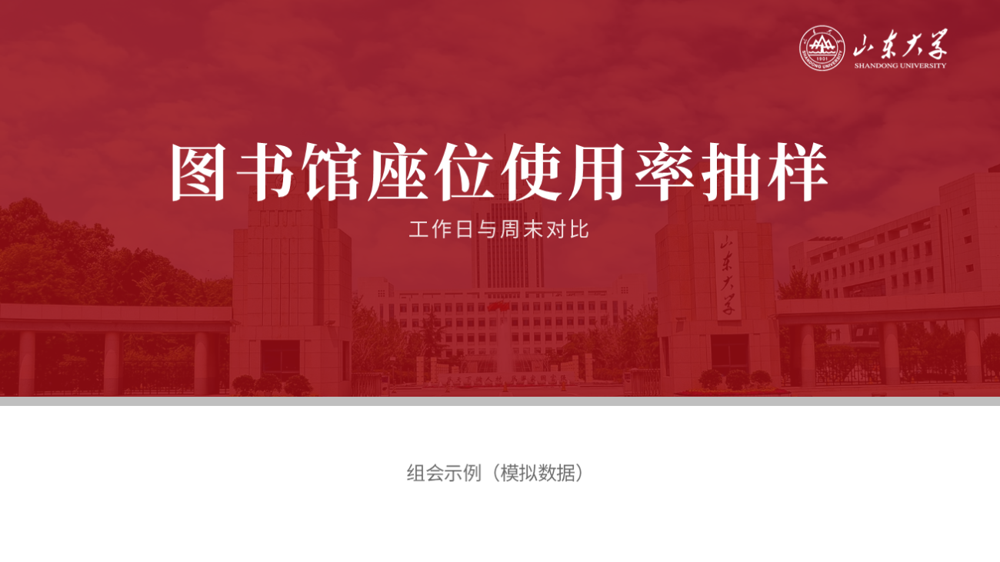
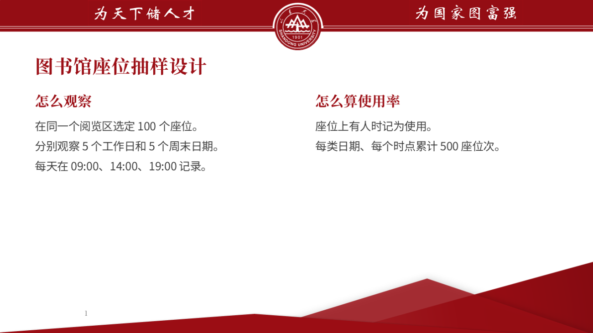
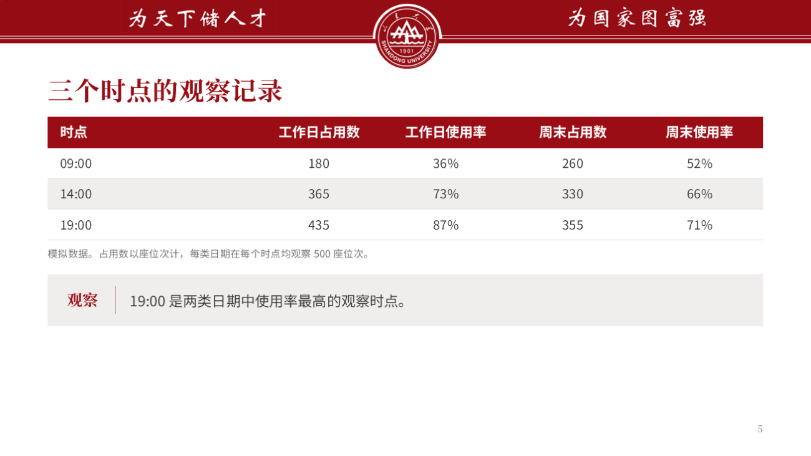
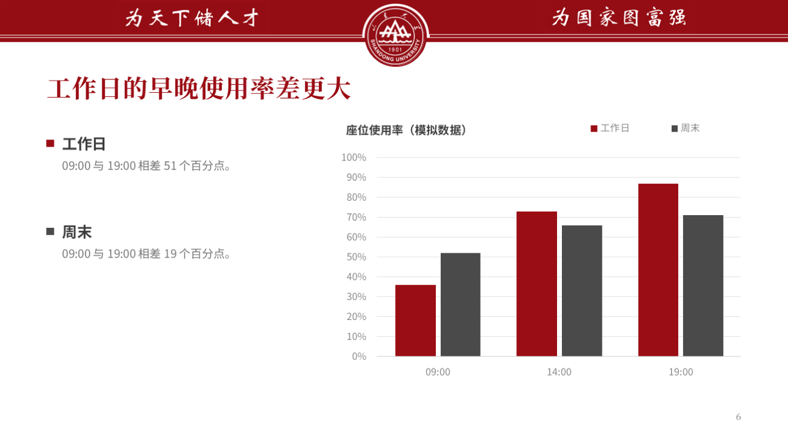

# 山东大学 PPT 技能

`sdu-ppt-hybrid` 用于制作可编辑的 PowerPoint，适合组会、开题、研究汇报和答辩。默认从**山东大学官方通用模板第 1 套**的原生母版出发，保留校园封面、红色校训横栏和居中校徽。正文沿用 GitHub 版的字体、文字层级和图文排版，较疏的页面可以选用模板 1 的山形页脚。

## 模板 1 预览

以下页面由 PowerPoint 实际渲染。示例用模拟数据比较工作日和周末的图书馆座位使用率。

| 封面 | 正文与山形页脚 |
| --- | --- |
|  |  |

| 原生表格 | 原生柱状图 |
| --- | --- |
|  |  |

## 选择模板

| 选项 | 效果 |
| --- | --- |
| `official-first`（默认） | 使用官方模板 1 的母版和校园视觉，按 GitHub 版排版 |
| `github` | 使用 GitHub 版原有的母版和视觉 |

两种模式都使用思源宋体（Noto Serif SC）和思源黑体（Noto Sans SC）。同一份 [JSON 内容计划](examples/hybrid-demo.json) 可以切换模式。文本、表格和由数据生成的图表都可以在 PowerPoint 里编辑。[模板与素材来源](references/hybrid-template.md)

## 快速开始

**在 Codex 中使用**。下载或克隆整个仓库，把目录命名为 `sdu-ppt-hybrid` 并放到技能目录。技能入口是 [SKILL.md](SKILL.md)。

> 用 $sdu-ppt-hybrid，选官方模板第 1 套，把我提供的材料做成一份 10 分钟的组会 PPT。

**用命令行生成**。需要 Python 3.9 或更新版本。

```sh
git clone https://github.com/zhendenanbeng/SDU-PPT-SKILL.git sdu-ppt-hybrid
cd sdu-ppt-hybrid
python -m pip install python-pptx Pillow
python scripts/sdu_ppt.py build examples/hybrid-demo.json out/demo.pptx --style official-first
python scripts/render.py out/demo.pptx out/preview --sheet
```

把 `--style official-first` 改为 `--style github` 可生成 GitHub 原版。预览脚本支持 PowerPoint 或 LibreOffice。安装对应字体可保持字形和换行一致。[字体说明](assets/fontconfig/README.md)

## 版式和接口

- [页型目录](references/catalog.md)列出封面、图文、图表、表格和答辩页等可用版式及字段。
- [场景页序](references/scenarios.md)提供组会、文献汇报、开题和答辩的选页示例。
- [API 与命令](references/api.md)说明文字、图片、图表和演讲者备注的填充方法。
